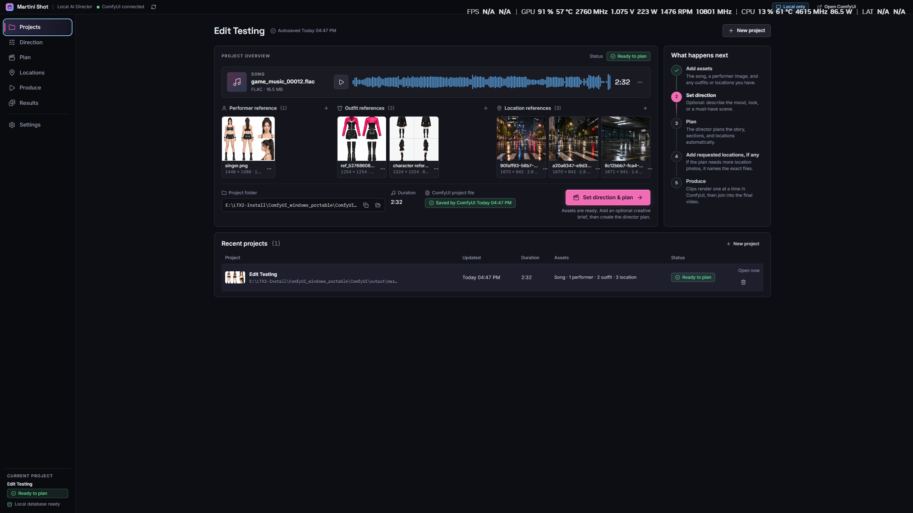
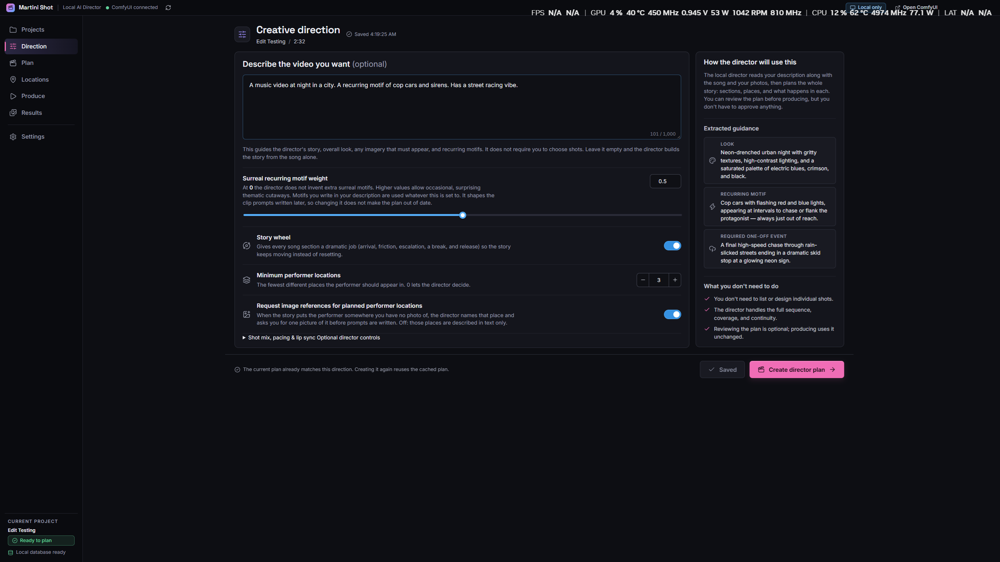
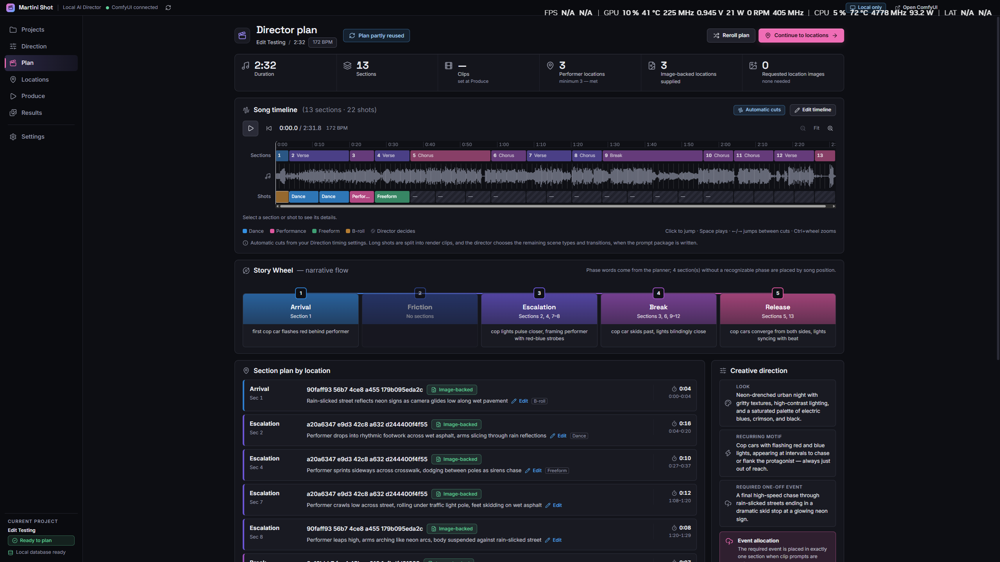
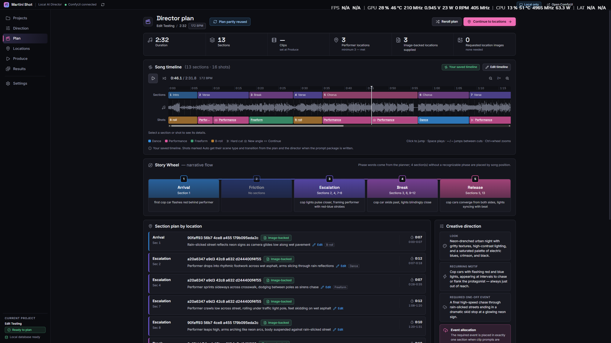
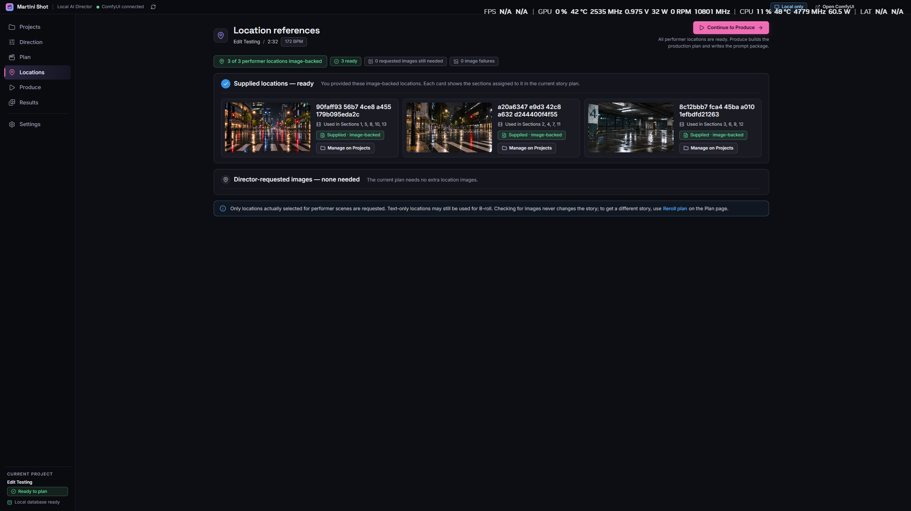
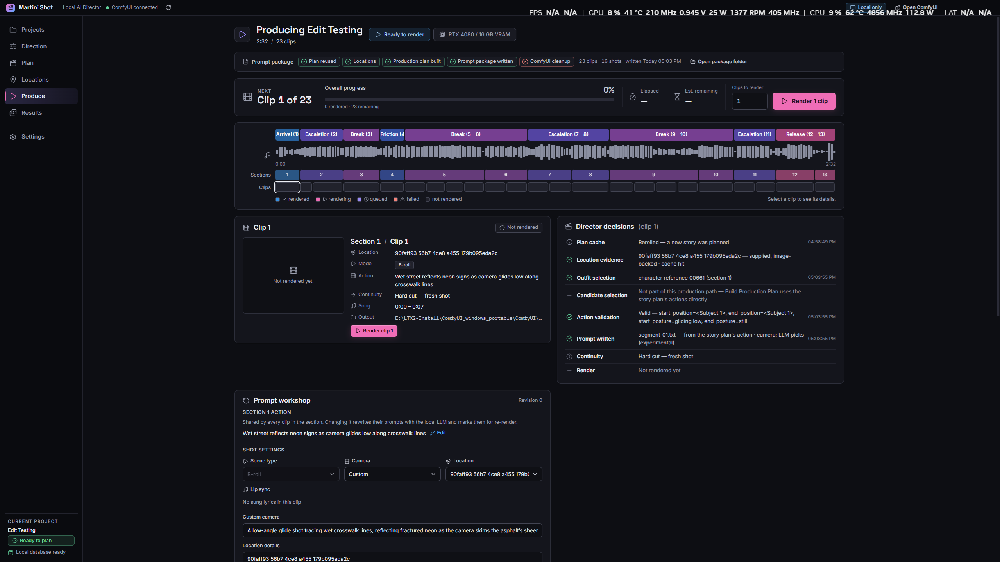
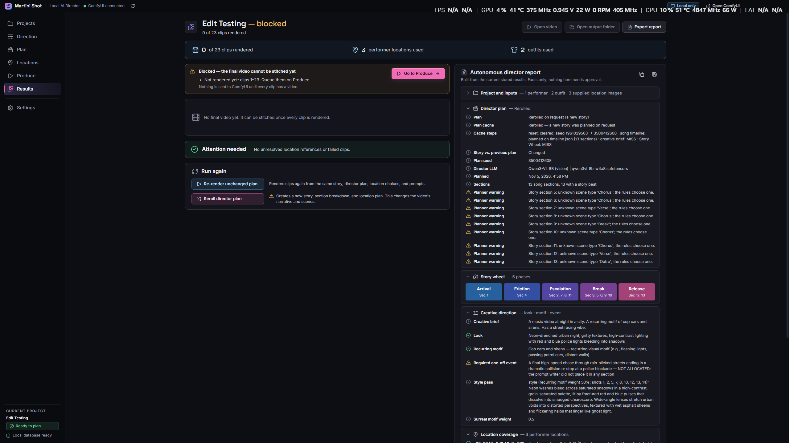

# Martini Shot

Martini Shot is a desktop app for turning a song, performer images, and a creative idea into an AI-generated music video. It helps musicians and creators take a video from its initial concept through story planning, clip generation, and a finished video set to their song.

You provide the music and visual direction. Martini Shot's AI director develops the story and writes the shot prompts, while the app keeps your references, plans, rendered clips, and final videos together in one project.

## From song to music video

### 1. Start with your song and performer

Create a project and add your song and at least one performer image. Outfit and location references help establish the video's look, with everything collected in one place before you begin.

### 2. Describe your vision

In Direction, describe the mood, style, or story you have in mind. You can guide recurring imagery and how the story develops, or leave the brief empty and let the director take the lead.

### 3. See the story take shape

Generate a director plan to turn your idea into a story built around the song. The Plan view brings together song sections, suggested shots, locations, and the story's progression so you can see how the video will unfold.

Want more control over the pacing? Edit the timeline to adjust sections, shot timing, scene types, and transitions. The example below shows a saved timeline with a mix of performance, dance, freeform, and B-roll shots.

### 4. Set the scene

Locations shows which reference images the story uses and where they appear. Add any extra location images the director requests, then continue when the visual references are ready. In this example, the three supplied locations cover the plan.

### 5. Bring the shots to life

In Produce, the director turns the plan into prompts ready to render. Choose how many clips to generate, follow progress across the song, and inspect each shot's action, camera, and location. You can refine individual shots as you work.

### 6. Review and finish your video

Results brings together render status and the director's report. Once every clip is rendered, stitch them together with your song, play the finished video, and open its file. You can also re-render selected clips and assemble a new version while keeping earlier final videos.

The screenshot below shows the project before rendering is complete: Results identifies the remaining clips and directs you back to Produce before the final video can be assembled.

## Your project, on your computer

Your project library, source assets, and finished videos stay on your PC. You can run the AI work on a suitable local GPU or connect a remote RunPod worker when you need cloud GPU capacity. Remote work uploads the files it needs and brings the resulting files back into your local project.

Martini Shot is currently in early development. Using it requires a separate ComfyUI setup with the Martini Shot nodes and compatible AI models, either locally or on a remote worker. The technical sections below explain how the desktop app and rendering setup fit together.

## Technical overview

The desktop app uses Electron and React, with SQLite for its local project database. It submits staged workflows to ComfyUI for project creation, song analysis, story planning, prompt writing, rendering, and stitching.

- [`src/`](src/) contains the desktop interface.
- [`electron/`](electron/) contains project storage, workflow execution, and local/remote worker integration.
- [`comfyui/custom_nodes/MartiniShot/`](comfyui/custom_nodes/MartiniShot/) contains the app's ComfyUI nodes.
- [`workflows/`](workflows/README.md) documents the workflow templates and their inputs and outputs.
- [`cloud/runpod/`](cloud/runpod/README.md) contains remote worker setup and deployment instructions.

## Development

1. Install Node.js and npm, then run `npm install` in this repository.
2. Prepare a ComfyUI worker with the Martini Shot nodes and the models required by the [workflow templates](workflows/README.md). For a remote worker, follow the [RunPod setup guide](cloud/runpod/README.md).
3. Run `npm run dev` to start the desktop app.
4. In Settings, configure the local project output folder and ComfyUI connection. Choose **This PC** or **Remote ComfyUI worker** as the workflow destination; for a remote worker, enter its endpoint and token.

On first launch, Martini Shot automatically creates its local SQLite database at `%APPDATA%\Martini Shot\martini-shot.db`. No database server, password, port, or `.env` file is required. The `.env.example` file is optional and only lets developers override the local ComfyUI address or SQLite data folder.

## Cloud ComfyUI (RunPod)

The [RunPod setup guide](cloud/runpod/README.md) sets up a pod with ComfyUI, the MartiniShot nodes, and the models. The selected worker can execute planning, prompt writing, rendering, and stitching. The app syncs project files before remote work and downloads changed artifacts afterwards; you can switch destinations between stages or clips.

[Runpod Template](https://console.runpod.io/hub/template/xyey15y07l?ref=enldftma)

For node development, run `tools/sync-martinishot.ps1` to copy the latest nodes from the local ComfyUI install into the repo before committing.

## Windows distribution

Run `npm run dist`. electron-builder writes an NSIS installer to `release/`.

The installed app needs a configured local or remote ComfyUI worker with the required nodes and models. Martini Shot manages its own small local project database; the desktop installer does not start, update, or bundle ComfyUI or its models.
